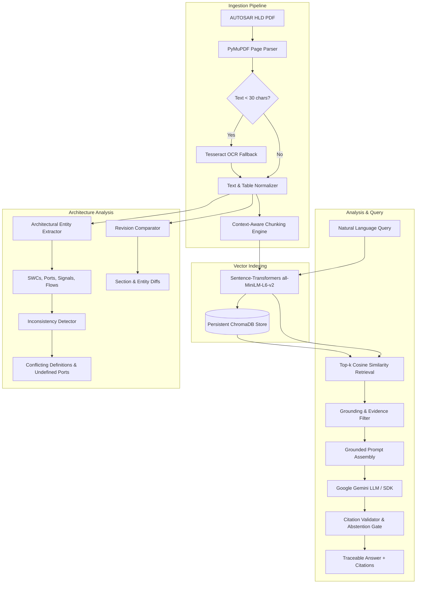

# System Architecture — AUTOSAR HLD Document Analysis Assistant

## 1. Architectural Overview
The **AUTOSAR HLD Document Analysis Assistant** is designed as a modular, evidence-grounded analysis platform for automotive systems and software engineering. It bridges unstructured engineering documentation with vector-indexed retrieval and verified generative reasoning.

---

## 2. Component Decomposition

### 2.1 PDF Ingestion Pipeline (`src/ingestion.py`)
- **PyMuPDF Engine**: Parses PDF pages sequentially, preserving exact page indices (1-indexed).
- **Heading Extractor**: Identifies hierarchical section titles using standard AUTOSAR patterns (`Section X: ...`, `X.Y ...`).
- **Table Extractor**: Detects and serializes structural interface/signal tables into clean Markdown.
- **OCR Fallback**: Gracefully detects scanned or low-text pages and invokes Tesseract when available; skips cleanly with an informative warning if unavailable.
- **Document Checksum**: Generates a stable SHA-256 digest to prevent duplicate indexing.

### 2.2 Context-Aware Chunking Engine (`src/chunking.py`)
- Splits text preserving structural paragraph and section boundaries.
- Retains table blocks as discrete atomic units.
- Attaches comprehensive metadata to every chunk: `doc_id`, `filename`, `page_num`, `section`, `chunk_index`, `doc_hash`, `char_count`.

### 2.3 Vector Store & Embedding Manager (`src/embeddings.py`, `src/vector_store.py`)
- Uses local `all-MiniLM-L6-v2` (384-dimensional embeddings).
- ChromaDB local persistent storage in `./chroma_db`.
- Supports document-specific filtering, duplicate prevention, and atomic document deletion.

### 2.4 RAG Retrieval & Grounding Pipeline (`src/rag_pipeline.py`)
- Retrieves top-k most relevant evidence passages.
- Evaluates domain relevance; if a query asks for topics completely absent from the document, triggers grounded abstention.
- Passes retrieved passages to Google Gemini with strict anti-hallucination prompt constraints.
- Validates emitted citations `[Doc: ..., Page: ..., Section: ...]` against retrieved source chunks.
- Seamlessly falls back to **Retrieval-Only Mode** if Gemini API key is absent or offline.

### 2.5 Architectural Entity Extractor (`src/entity_extractor.py`)
- Pydantic-validated parsing of:
  - **Software Components (SWCs)**: Atomic, Composition, Sensor/Actuator SWCs.
  - **Ports**: Provided Ports (`Pp...`) and Required Ports (`Rp...`).
  - **Interfaces**: Sender-Receiver and Client-Server interfaces (`If_...`).
  - **Signals**: Data elements with data types, units, and transmission cycle times (`Sig_...`).
  - **Functional Flows**: Multi-component execution chains.
  - **Safety Requirements**: ASIL integrity levels and ISO 26262 norms.

### 2.6 Document Revision Comparator (`src/doc_comparison.py`)
- Structural diffing between two document revisions.
- Detects added sections, removed sections, modified text, and newly introduced or deprecated architectural entities.
- Analyzes downstream architectural impacts.

### 2.7 Potential Inconsistency Detector (`src/issue_detector.py`)
- Identifies:
  - Conflicting transmission cycle times across sections (e.g. 10ms vs 50ms).
  - Undefined interface prototypes referenced by ports.
  - Undeclared software components referenced in functional flow diagrams.
  - Broken cross-references.
